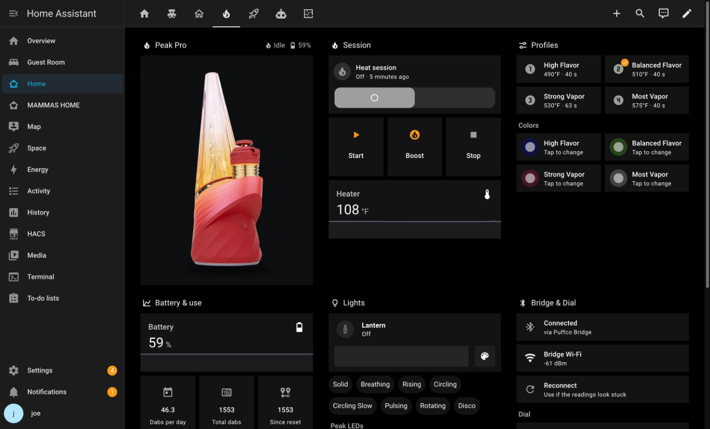

# PEAKHAUS

My Puffco Peak Pro, fully in Home Assistant.

Heat sessions, the four heat profiles with their names, temperatures and colours, battery, dab counters, the lantern and its effects, stealth mode and the LED brightness controls, all as normal Home Assistant entities. The Peak talks to Home Assistant through an eight dollar ESP32 Bluetooth bridge (an M5Stack ATOM Lite). An M5Dial can sit next to the rig as a physical knob remote. A ready-made dashboard page ties it together. Tested on a Peak Pro Daybreak with the 3DXL chamber.



## Why this exists

The HA-Puff integration ([HA-Puff/home-assistant-puffco](https://github.com/HA-Puff/home-assistant-puffco), MIT) already knew how to speak the Peak's Lorax protocol. It just could not pair on Home Assistant OS. Pairing died within a fraction of a second with an authentication failure, and the protocol replies never arrived.

Working it out took a few evenings. The Peak ignores every Lorax command until the Bluetooth Low Energy (BLE) link is encrypted. Reading the app-version characteristic is what forces the operating system to pair. On a Mac that worked, because macOS put up a pairing popup and I clicked it. Home Assistant OS has no BlueZ pairing agent, so its adapter is never bondable, and the Raspberry Pi 5 radio drops the link the moment the central side asks to pair anyway.

An ESPHome Bluetooth proxy changes the picture. Through the proxy the same read comes back as GATT error 0x0F, insufficient encryption, and the ESP32 will not start Security Manager Protocol pairing from that on its own. So on the ESPHome backend this integration calls pair first, then runs the normal Lorax handshake. The bond lives in the ESP32. The Peak only accepts that first connection while it is in pairing mode (the blue pulse). After that it reconnects on its own.

Profile colours were the other fix. The Peak stores them as CBOR, `{lamp: {name, param: {color}}}`, with animated profiles carrying a long colour string. This integration reads and writes that shape, so the colour you pick in Home Assistant is the colour the ring shows.

Everything in `custom_components/puffco` builds on HA-Puff's work and keeps their MIT licence.

## Hardware

| Part | Role | Notes |
|---|---|---|
| M5Stack ATOM Lite | Bluetooth bridge | ESP32-PICO, USB-C, about eight dollars. Lives within a few metres of the rig. |
| M5Stack M5Dial (optional) | Knob remote and display | ESP32-S3 with a round 240x240 screen. Talks only to Home Assistant, not to the Peak. |
| Puffco Peak Pro | The rig | Tested on firmware AW-1d90ae, Daybreak edition with the 3DXL chamber. |

Entity names like `peak_pro_02743` come from the device. Yours will carry your Peak's own number.

## Install

### 1. The integration

1. In HACS, add `https://github.com/SRVR-JOE/peakhaus` as a custom repository, category Integration.
2. Download it and restart Home Assistant.
3. Do not install the upstream HA-Puff repository alongside it. Both use the `puffco` domain and an update from the other would overwrite the pairing fix.

### 2. The bridge

1. Flash `esphome/puffco-bridge.yaml` to the ATOM Lite. [esphome/README-flash.md](esphome/README-flash.md) walks through it.
2. Adopt the bridge in Home Assistant when it is discovered (Settings, Devices, ESPHome).
3. Power the bridge from any USB port near where you use the Peak.

### 3. Pairing

1. Turn the Peak fully off, then hold the power button until the ring pulses blue.
2. In Home Assistant, add the Puffco integration. It finds the Peak through the bridge and pairs.
3. If the first attempt fails, keep the Peak pulsing and retry. The pairing window is short.

### 4. The dashboard page

The `dashboard/` folder holds the scripts that build the page in the screenshot. `peak_cards.py` builds the view, `patch_peak_into_live.py` validates every template against your instance and pushes it. They expect the Mushroom cards from HACS and a long-lived token in `~/.ha_token`. The rig artwork is made by `dashboard/art/make_peak_rig.py` (it needs the transparent Daybreak product render `daybreak_3q.webp` beside it, which is not redistributed here) and uploaded with `upload_art.py`.

The Session column's day charts need two extras: the `apexcharts-card` plugin from HACS, and a template binary sensor helper named **Peak recent hit** (Settings, Helpers, Template, Binary sensor) with this state, which holds each session on for 20 minutes so hits are visible on an 18-hour axis:

```
{{ is_state('switch.peak_pro_02743_heat_session','on') or (states.switch.peak_pro_02743_heat_session is not none and (now() - states.switch.peak_pro_02743_heat_session.last_changed) < timedelta(minutes=20)) }}
```

### Things that will bite you

- If the integration lands in a `failed_unload` state after a connection timeout, nothing but a Home Assistant restart clears it. Reload and disable both refuse.
- An ESPHome proxy feeds raw advertisements to one API subscriber. A test script that subscribes knocks Home Assistant off the proxy. Reload the ESPHome entry afterwards.
- Rebooting or flashing the bridge while the Peak is connected leaves the coordinator holding a lock. Reload the Puffco entry and it reconnects.
- The bond is per ESP32. A new bridge means one more trip through pairing mode.

## Entities

Everything below exists on my instance today, prefixed `peak_pro_02743_`.

| Entity | What it does |
|---|---|
| `switch.heat_session` | Start or stop a heat session |
| `switch.stealth_mode` | Stealth mode |
| `button.start_session`, `button.boost_session`, `button.abort_session` | Session control as buttons |
| `button.reconnect` | Force a reconnect |
| `sensor.battery` | Battery percentage |
| `sensor.heater_temperature` | Live heater temperature |
| `sensor.heat_time_remaining`, `sensor.heat_cycle_timer` | Countdown while a session runs |
| `sensor.total_dabs`, `sensor.dabs_per_day`, `sensor.trip_dabs` | Counters |
| `select.active_profile` | Which of the four profiles is active |
| `number.profile_N_temperature`, `number.profile_N_duration` | Per-profile target and session length |
| `number.profile_N_boost_temperature`, `number.profile_N_boost_duration` | Per-profile boost settings |
| `number.led_brightness_main`, `_ring`, `_glass`, `_battery` | LED brightness zones |
| `number.lantern_brightness` | Lantern brightness |
| `text.profile_N_name` | Profile names |
| `light.lantern` | Lantern with colour and effects |
| `light.profile_N_color` | Each profile's ring colour |
| `binary_sensor.awake` | Whether the Peak is awake |
| `climate.heater` | Heater as a climate entity |
| `event.session` | Session events for automations |

## The Dial

The M5Dial is a remote, not a bridge. It reads everything from Home Assistant, so it works wherever it has Wi-Fi, and it does not need to be near the Peak.

- Turn the knob to pick a profile. The choice commits after a short pause.
- Tap the screen for the stats page.
- Hold the knob to start or stop a heat session.
- While heating, the ring fills, flashes at Ready, then counts down.

There are seven faces, selectable from Home Assistant: Ring, Race Tach, Ferrari, Porsche, Minimal, Segments and Twin. The tachometer faces sweep the needle on boot and mark the redline from the active profile. The screen dims after a minute idle when the Peak is asleep. No sounds. The config is `esphome/puffco-dial.yaml`.


## Credits and licence

- [HA-Puff/home-assistant-puffco](https://github.com/HA-Puff/home-assistant-puffco) for the integration this builds on, MIT.
- [ESPHome](https://esphome.io) for the Bluetooth proxy and the Dial firmware.
- Puffco for the Peak Pro. This project is not affiliated with Puffco.

MIT. See [LICENSE](LICENSE).
